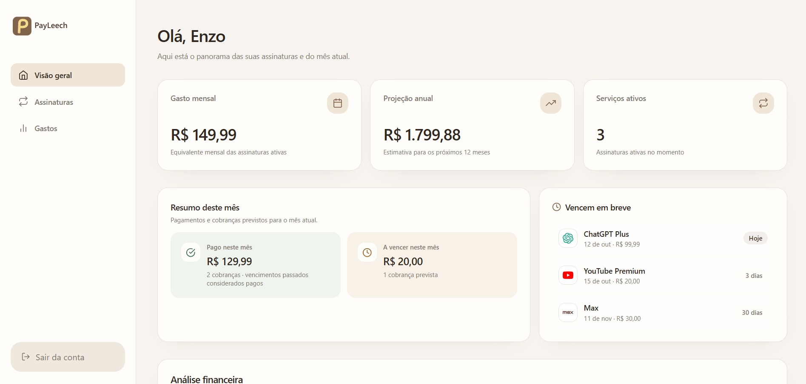
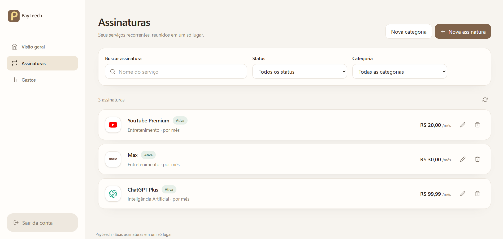
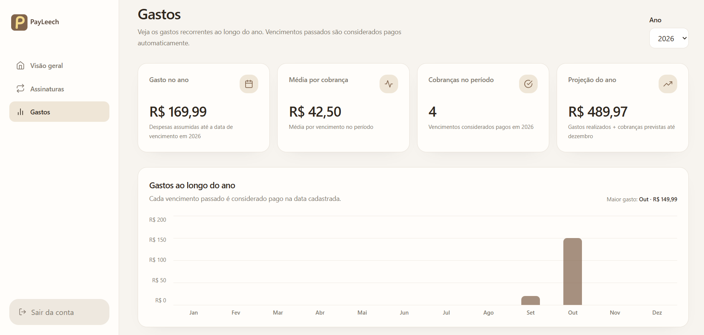
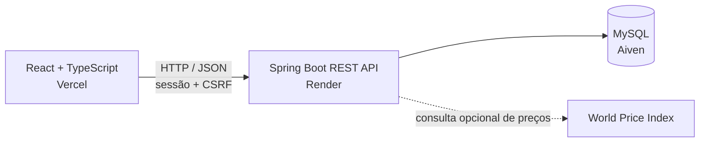

<div align="center">

# PayLeech

**Suas assinaturas, em ordem.**

Organize serviços recorrentes, acompanhe cobranças e entenda quanto eles representam no seu orçamento.

[Aplicação online](https://pay-leech.vercel.app/) · [Swagger UI](https://payleech-api.onrender.com/swagger-ui/index.html) · [Repositório](https://github.com/EnzoNukui/PayLeech)


</div>

---

## Visão geral

O PayLeech é uma aplicação full stack para acompanhar assinaturas digitais e outros serviços recorrentes. Cada pessoa mantém suas próprias categorias, assinaturas e histórico de cobranças; o painel reúne os valores em um resumo mensal e em gráficos anuais.

O projeto foi pensado para responder perguntas simples: quanto gasto com serviços recorrentes, o que vence em breve e como esses custos se distribuem ao longo do ano.

## Prévia

<p align="center">
  
</p>

<p align="center">
  
  
</p>

## O que você pode fazer

- Cadastrar-se e entrar com e-mail e senha.
- Organizar assinaturas em categorias próprias.
- Registrar serviços, valores, periodicidade, data de cobrança e ícone.
- Filtrar assinaturas por nome, status e categoria.
- Acompanhar o custo mensal equivalente, uma estimativa anual e o total de serviços ativos.
- Ver cobranças próximas, o tempo até cada vencimento e o resumo do mês.
- Consultar gastos por ano, média por cobrança, quantidade de vencimentos e projeção até dezembro.
- Registrar cobranças pagas e consultar o histórico.
- Consultar planos e preços sugeridos para alguns serviços, quando a fonte externa tiver cobertura.

### Como os valores são contabilizados

- Assinaturas mensais, trimestrais e anuais são normalizadas para permitir a comparação do custo mensal.
- A projeção do ano soma cobranças já vencidas e cobranças previstas até dezembro.
- Vencimentos passados são considerados pagos automaticamente na data prevista; cobranças futuras permanecem a vencer.
- Cada usuário acessa somente suas próprias categorias, assinaturas e cobranças.

## Arquitetura

O frontend é uma SPA em React. Ele conversa com a API Spring Boot por HTTP/JSON, usando uma sessão com cookie e proteção CSRF. O backend persiste os dados em MySQL.



## Tecnologias

| Camada | Tecnologias |
| --- | --- |
| Frontend | React 19, TypeScript, Vite, React Router, Tailwind CSS, Motion e React Icons |
| Backend | Java 21, Spring Boot, Spring Web, Spring Data JPA, Spring Security e Bean Validation |
| Banco de dados | MySQL 8 e Hibernate/JPA |
| Documentação | OpenAPI e Swagger UI |
| Hospedagem | Vercel (frontend), Render (API) e Aiven (MySQL) |
| Preços sugeridos | World Price Index, com chave de API configurada no backend |

## API REST

A API de produção está disponível em `https://payleech-api.onrender.com`. Os endpoints abaixo não usam um prefixo `/api`.

### Autenticação e conta

| Método | Endpoint | Acesso | Descrição |
| --- | --- | --- | --- |
| `GET` | `/auth/csrf` | Público | Cria/retorna o token CSRF e o nome do cabeçalho esperado. |
| `POST` | `/auth/cadastro` | Público + CSRF | Cria uma conta. |
| `POST` | `/auth/login` | Público + CSRF | Autentica e inicia uma sessão. |
| `GET` | `/auth/me` | Sessão | Retorna os dados da conta autenticada. |
| `PATCH` | `/auth/limite-mensal` | Sessão + CSRF | Atualiza o limite mensal definido pelo usuário. |
| `POST` | `/auth/logout` | Sessão + CSRF | Encerra a sessão. |

### Categorias

| Método | Endpoint | Descrição |
| --- | --- | --- |
| `GET` | `/categorias` | Lista as categorias da conta. |
| `GET` | `/categorias/{id}` | Busca uma categoria. |
| `POST` | `/categorias` | Cria uma categoria. |
| `PUT` | `/categorias/{id}` | Atualiza uma categoria. |
| `DELETE` | `/categorias/{id}` | Exclui uma categoria sem assinaturas vinculadas. |

### Assinaturas

| Método | Endpoint | Descrição |
| --- | --- | --- |
| `GET` | `/assinaturas` | Lista assinaturas; aceita `status` e `categoriaId` como filtros. |
| `GET` | `/assinaturas/proximas-cobrancas` | Lista os próximos vencimentos das assinaturas ativas. |
| `GET` | `/assinaturas/{id}` | Busca uma assinatura. |
| `POST` | `/assinaturas` | Cria uma assinatura. |
| `PUT` | `/assinaturas/{id}` | Atualiza uma assinatura. |
| `DELETE` | `/assinaturas/{id}` | Exclui uma assinatura. |

Valores de `status`: `ATIVA`, `PAUSADA` ou `CANCELADA`. Valores de `periodicidade`: `MENSAL`, `TRIMESTRAL` ou `ANUAL`.

### Cobranças e resumo

| Método | Endpoint | Descrição |
| --- | --- | --- |
| `GET` | `/cobrancas` | Lista cobranças; aceita `status` como filtro (`PREVISTA`, `PAGA` ou `CANCELADA`). |
| `PATCH` | `/cobrancas/{id}/pagar` | Confirma o pagamento; o corpo pode informar `valorPago` e `dataPagamento`. |
| `GET` | `/resumo` | Retorna custo mensal equivalente, estimativa anual e quantidade de assinaturas ativas. |

### Consulta de preços

| Método | Endpoint | Parâmetros | Descrição |
| --- | --- | --- | --- |
| `GET` | `/servicos/precos/planos` | `servico` | Lista os planos encontrados para o serviço. |
| `GET` | `/servicos/precos` | `servico`, `plano`, `pais` opcional | Consulta o preço disponível para um plano e país. O país padrão é `BRA`. |

A consulta externa de preços depende de `WORLD_PRICE_INDEX_API_KEY`. Os provedores atualmente integrados são Netflix, Spotify, Adobe, Disney+, YouTube Premium e Revolut. Ela é uma sugestão de preenchimento; o usuário continua podendo informar o preço manualmente.

### Sessão e CSRF

Os endpoints de negócio exigem autenticação. O cadastro, o login e qualquer operação de escrita também exigem o token CSRF. Para chamadas manuais com Insomnia ou outro cliente:

1. Faça `GET /auth/csrf` e preserve o cookie `JSESSIONID` recebido.
2. Envie o valor de `token` no cabeçalho indicado por `headerName` (atualmente `X-CSRF-TOKEN`) ao fazer cadastro ou login.
3. Depois do login, consulte `/auth/csrf` novamente e mantenha o cookie de sessão.
4. Envie o cookie e o token CSRF nas operações `POST`, `PUT`, `PATCH` e `DELETE` protegidas.

Os endpoints `GET /v3/api-docs` e `/swagger-ui/index.html` estão disponíveis para consultar os modelos e respostas da API.

### Exemplo: criar uma assinatura

```http
POST /assinaturas
Content-Type: application/json
X-CSRF-TOKEN: <token>
Cookie: JSESSIONID=<sessao>
```

```json
{
  "nome": "YouTube Premium",
  "valor": 20.00,
  "periodicidade": "MENSAL",
  "dataPrimeiraCobranca": "2026-10-15",
  "statusAssinatura": "ATIVA",
  "categoriaId": 1,
  "icone": "simple-icons:youtube"
}
```

## Executar localmente

### Pré-requisitos

- Java 21
- Node.js e npm
- MySQL 8

### 1. Preparar o banco

Inicie o MySQL e execute o script de criação do esquema:

```text
backend/src/main/resources/db/schema-mysql.sql
```

O Hibernate está configurado para validar o esquema existente; ele não cria nem altera as tabelas automaticamente.

### 2. Configurar e iniciar o backend

No PowerShell, defina as variáveis de ambiente para a sessão atual. Ajuste usuário e senha conforme seu MySQL:

```powershell
$env:DB_HOST = "localhost"
$env:DB_PORT = "3306"
$env:DB_NAME = "payleech"
$env:DB_USERNAME = "root"
$env:DB_PASSWORD = "sua_senha_mysql"
$env:APP_CORS_ALLOWED_ORIGINS = "http://localhost:5173"
# Opcional: habilita consultas externas de preços
$env:WORLD_PRICE_INDEX_API_KEY = "sua_chave"

cd backend
.\mvnw.cmd spring-boot:run
```

A API inicia por padrão em `http://localhost:8080`. A documentação local fica em `http://localhost:8080/swagger-ui/index.html`.

### 3. Configurar e iniciar o frontend

Em outro terminal:

```powershell
cd frontend
npm install
```

Crie `frontend/.env.local` com o endereço do backend:

```env
VITE_API_BASE_URL=http://localhost:8080
```

Inicie a aplicação:

```powershell
npm run dev
```

O Vite exibirá no terminal o endereço local do frontend, normalmente `http://localhost:5173`.

### Comandos úteis

| Diretório | Comando | Descrição |
| --- | --- | --- |
| `frontend` | `npm run dev` | Inicia o servidor local. |
| `frontend` | `npm run build` | Verifica os tipos e gera os arquivos de produção. |
| `frontend` | `npm run lint` | Analisa o código com Oxlint. |
| `backend` | `.\mvnw.cmd test` | Executa os testes automatizados. |
| `backend` | `.\mvnw.cmd spring-boot:run` | Inicia a API local. |

## Estrutura do repositório

```text
payLeech/
├── backend/
│   ├── src/main/java/br/com/payleech/
│   │   ├── config/          # Segurança, CORS e OpenAPI
│   │   ├── controller/      # Endpoints REST
│   │   ├── dto/             # Dados de entrada e saída da API
│   │   ├── entity/          # Entidades JPA
│   │   ├── enums/           # Periodicidade e status
│   │   ├── exception/       # Tratamento de erros
│   │   ├── repository/      # Acesso ao banco
│   │   ├── security/        # Sessões e identidade do usuário
│   │   └── service/         # Regras de negócio
│   └── src/main/resources/db/ # Esquema e scripts SQL
├── frontend/
│   ├── public/              # Arquivos públicos
│   └── src/
│       ├── components/      # Componentes reutilizáveis
│       ├── pages/            # Telas da aplicação
│       ├── routes/           # Rotas e proteção de acesso
│       ├── service/          # Cliente HTTP e integração com a API
│       ├── types/            # Tipos compartilhados
│       └── globals.css       # Tokens e estilos globais
└── docs/images/              # Capturas usadas nesta documentação
```

## Deploy

- **Frontend:** Vercel — [pay-leech.vercel.app](https://pay-leech.vercel.app/)
- **Backend:** Render — [payleech-api.onrender.com](https://payleech-api.onrender.com/)
- **Banco de dados:** MySQL no Aiven

Em produção, configure as variáveis de banco de dados, CORS e chave opcional da fonte de preços no ambiente do backend. No projeto Vercel, configure `VITE_API_BASE_URL` com a URL pública da API. Não publique senhas, tokens ou chaves no repositório.

## Autor

Desenvolvido por **Enzo Nukui**.

- [GitHub](https://github.com/EnzoNukui)
- [LinkedIn](https://www.linkedin.com/in/enzo-nukui/)

---

<div align="center">

PayLeech — mais clareza para acompanhar o que você assina.

</div>
